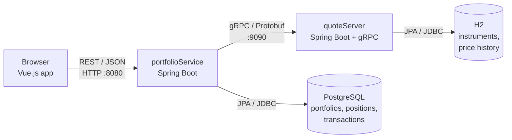
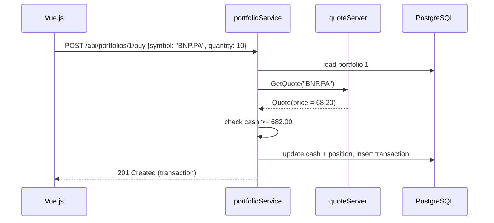

# Architecture – Portfolio Desk

## 1. Goal

Portfolio Desk is a small trading application. A user creates investment portfolios,
deposits cash, buys and sells Paris-listed stocks, and sees the live value and profit
or loss (P&L) of each portfolio.

Prices are **simulated** by a dedicated market data service (random walk). They are not real market data.

## 2. Overview



This follows the architecture advised in the subject:
**Client → REST web service (RPC client) → RPC server**, each service with its own database.

| Module | Role | Tech | Port |
|---|---|---|---|
| `portfolio-frontend` | User interface | Vue 3, Vite | 5173 (dev) / 3000 (Docker) |
| `portfolioService` | REST API, business rules, gRPC client | Spring Boot 3, Spring Data JPA | 8080 |
| `quoteApi` | Shared gRPC contract (`.proto`) | Protobuf, grpc-java | – |
| `quoteServer` | gRPC server, market data simulation | Spring Boot 3, grpc-java, JPA | 9090 |
| PostgreSQL | Portfolio database | PostgreSQL 16 | 5432 |
| H2 | Market data database | H2 in-memory | – |

## 3. Services

### quoteServer (RPC server)

- Stores 10 CAC 40 stocks (`Instrument`) and their price history (`PriceTick`).
- Every 3 seconds, a scheduled task moves each price by a random amount (max ±0.8%).
- Exposes 3 gRPC methods, defined in `quoteApi/src/main/proto/quote_service.proto`:

| RPC | Input | Output | Errors |
|---|---|---|---|
| `ListInstruments` | `Empty` | `InstrumentList` | – |
| `GetQuote` | `QuoteRequest(symbol)` | `Quote` | `NOT_FOUND`, `INVALID_ARGUMENT` |
| `GetQuotes` | `QuotesRequest(symbols[])` | `QuoteList` | – |

### portfolioService (REST web service + RPC client)

- Manages portfolios, positions and transactions in PostgreSQL.
- Gets the current price from the quote server (gRPC) for every trade and valuation.
- Business rules:
  - a buy needs enough cash;
  - a sell needs enough shares;
  - the average cost of a position is a weighted average of the buy prices;
  - a sale books a realized P&L = (sell price − average cost) × quantity.

REST endpoints:

| Method | URL | Description | Success |
|---|---|---|---|
| GET | `/api/instruments` | List tradable stocks | 200 |
| GET | `/api/quotes/{symbol}` | Current quote of one stock | 200 |
| GET | `/api/quotes?symbols=A,B` | Current quotes of several stocks | 200 |
| GET | `/api/portfolios` | List portfolios | 200 |
| POST | `/api/portfolios` | Create a portfolio `{name, owner, initialCash}` | 201 |
| GET | `/api/portfolios/{id}` | Portfolio valued at market prices | 200 |
| DELETE | `/api/portfolios/{id}` | Delete a portfolio | 204 |
| POST | `/api/portfolios/{id}/deposit` | Add cash `{amount}` | 200 |
| POST | `/api/portfolios/{id}/withdraw` | Remove cash `{amount}` | 200 |
| POST | `/api/portfolios/{id}/buy` | Buy at market price `{symbol, quantity}` | 201 |
| POST | `/api/portfolios/{id}/sell` | Sell at market price `{symbol, quantity}` | 201 |
| GET | `/api/portfolios/{id}/transactions` | Transaction history | 200 |

## 4. Main flow: buying a stock



## 5. Layers

Each Spring Boot service is split into layers (one package per layer):

```
portfolioService/src/main/java/fr/efrei/finance/portfolio
├── web/           REST controllers + GlobalExceptionHandler   (web layer)
├── services/      business logic, transactions                (service layer)
├── client/        gRPC client of the quote server
├── repositories/  Spring Data JPA interfaces
├── entities/      JPA entities: Portfolio, Position, Transaction
├── dto/           request / response objects (Java records)
├── exceptions/    business exceptions
└── config/        Spring beans (gRPC channel, CORS)

quoteServer/src/main/java/fr/efrei/finance/quoteserver
├── rpc/           gRPC endpoint + server lifecycle            (web layer)
├── services/      market data simulation                      (service layer)
├── repositories/  Spring Data JPA interfaces
├── entities/      Instrument, PriceTick
├── exceptions/
└── config/        data seeding
```

## 6. Best practices applied

| Requirement | How it is done |
|---|---|
| One folder per service | `quoteApi/`, `quoteServer/`, `portfolioService/`, `portfolio-frontend/` (Gradle multi-module) |
| Layers | `web` / `services` / `entities` (+ `repositories`, `dto`) in each service |
| Inversion of Control | All dependencies are injected by Spring with `@Autowired` constructors. The gRPC channel and stub are Spring beans (`GrpcClientConfig`). |
| Logger | SLF4J `Logger` in every class. No `System.out`. |
| HTTP error handler | `GlobalExceptionHandler` (`@RestControllerAdvice`) returns a JSON error with status and message: 400 (validation), 404 (unknown portfolio/stock), 409 (concurrent update), 422 (not enough cash/shares), 503 (quote server down), 500. |
| gRPC errors | The server maps exceptions to gRPC status codes; the client maps them back to business exceptions. |
| Stateless | No HTTP session. Every request carries all needed data; all state is in the databases. Several instances of each service can run in parallel. Optimistic locking (`@Version`) protects concurrent trades. |

Example error response:

```json
{
  "timestamp": "2026-10-11T14:02:11.512Z",
  "status": 422,
  "error": "Unprocessable Entity",
  "message": "Insufficient funds: 1240.00 EUR required, 100.00 EUR available",
  "path": "/api/portfolios/1/buy"
}
```

## 7. Deployment

`docker-compose.yml` starts 4 containers: `postgres`, `quote-server`, `portfolio-service`, `frontend` (nginx).
nginx serves the Vue.js app and forwards `/api/*` to the portfolio service.

## 8. Tests

- `MarketDataServiceTest`: quote lookup, unknown symbol, price simulation bounds.
- `PortfolioServiceTest`: buy, weighted average cost, insufficient funds, sell with realized P&L, valuation.
- `PortfolioControllerTest`: HTTP status and JSON body for 400, 404, 422 and 503 errors.
